# Performance Analysis of Matrix Multiplication


## Executive Summary

This repository presents a detailed performance analysis of a 4000 × 4000 matrix multiplication workload using different computing models. The study evaluates and compares the execution times of a sequential CPU execution against three parallel implementations: OpenMP (shared-memory), MPI (distributed-memory), and CUDA (GPU acceleration). The Sequential implementation serves as the baseline, and the measured execution times are compared using relative speedup.

## Experiment Objectives

- To implement and execute a large-scale matrix multiplication (4000 × 4000) using Sequential, OpenMP, MPI, and CUDA models.
- To measure and compare the execution time of each model.
- To calculate the performance speedup of the parallel models relative to the sequential baseline.
- To verify the computational correctness of the results.

## Problem Definition

Matrix multiplication is a fundamental computational problem with $O(N^3)$ complexity. Given two matrices $A$ and $B$ of size $N \times N$, the resulting matrix $C$ is computed such that each element is the dot product of the corresponding row of $A$ and column of $B$:

$$C[i][j] = \sum_{k=0}^{N-1} A[i][k] \times B[k][j]$$

Due to its high computational intensity and independent element calculations, matrix multiplication is highly amenable to parallelization across multi-core CPUs and many-core GPUs.

## Workload Specification

- **Matrix A:** 4000 × 4000
- **Matrix B:** 4000 × 4000
- **Initialization:** All elements of matrices A and B are initialized to 1.0.

## Computing Models

1. **Sequential:** Standard single-threaded execution on a CPU. Used as the 1.00× performance baseline.
2. **OpenMP:** A shared-memory parallel computing model utilizing 16 threads.
3. **MPI (Message Passing Interface):** A distributed-memory parallel computing model utilizing 4 processes.
4. **CUDA:** A parallel computing platform and programming model for general computing on GPUs.

## Theoretical / Architectural Comparison

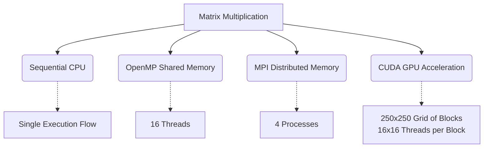

## Experiment Workflow

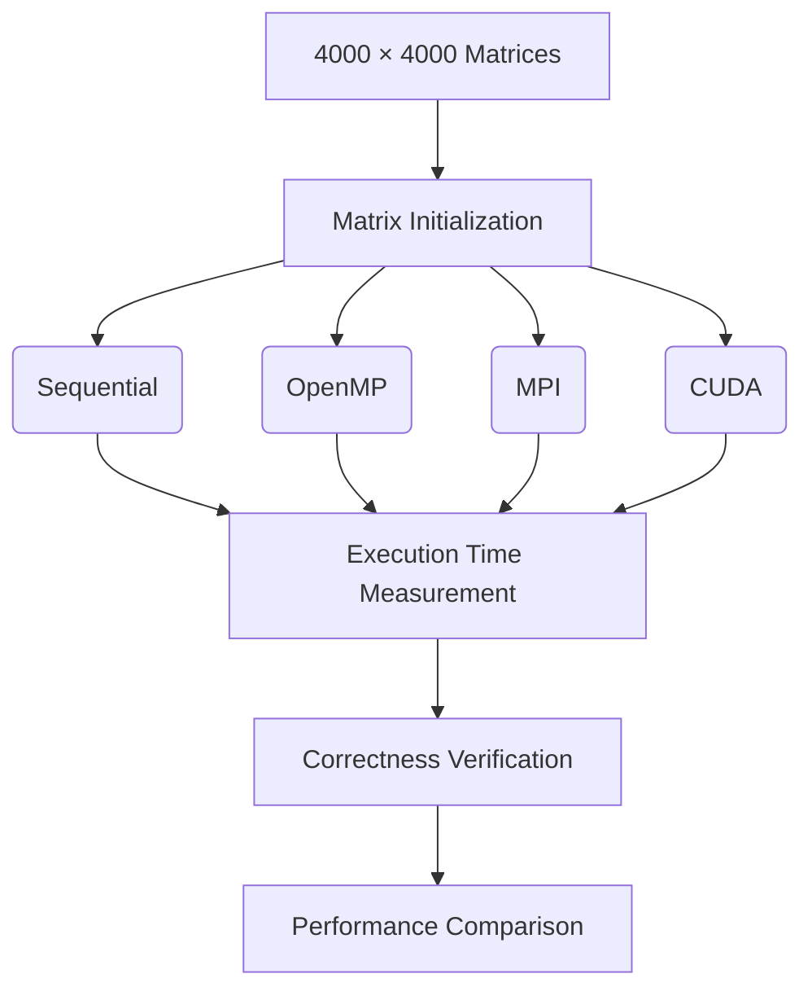

## Repository Structure

```text
PGC_Lab/
│
├── images/
│   ├── cuda_nvcc.png
│   ├── cuda_nvidia_smi.png
│   ├── cuda_result.png
│   ├── execution_time_chart.png
│   ├── mpi_result.png
│   ├── openmp_result.png
│   ├── performance_comparison.png
│   ├── sequential_result.png
│   └── speedup_chart.png
│
├── scripts/
│   └── generate_plots.py
│
├── src/
│   ├── cuda/
│   │   └── matrix_cuda.cu
│   ├── mpi/
│   │   ├── matrix_mpi.c
│   │   └── mpi_send_recv.c
│   ├── openmp/
│   │   └── matrix_openmp.c
│   └── sequential/
│       └── matrix_sequential.c
│
├── .gitignore
└── README.md
```

## Source Code References

| Model | Source File | Description |
|---|---|---|
| Sequential | [src/sequential/matrix_sequential.c](src/sequential/matrix_sequential.c) | Sequential matrix multiplication |
| OpenMP | [src/openmp/matrix_openmp.c](src/openmp/matrix_openmp.c) | OpenMP parallel matrix multiplication |
| MPI | [src/mpi/matrix_mpi.c](src/mpi/matrix_mpi.c) <br> [src/mpi/mpi_send_recv.c](src/mpi/mpi_send_recv.c) | MPI distributed matrix multiplication |
| CUDA | [src/cuda/matrix_cuda.cu](src/cuda/matrix_cuda.cu) | CUDA GPU matrix multiplication |

## Sequential Implementation

The sequential implementation serves as the baseline execution. It utilizes a single execution flow with a standard triple-nested loop to compute the matrix product, taking $O(N^3)$ operations.

## OpenMP Implementation

The OpenMP implementation leverages shared-memory parallelism. The outer loop of the matrix multiplication is parallelized using `#pragma omp parallel for`, distributing the workload across 16 threads, leading to a measured reduction in execution time.

## MPI Implementation

The MPI implementation uses distributed-memory parallelism with 4 processes. It utilizes a master-worker architecture where Rank 0 (master) distributes portions of the matrix to worker ranks (worker1, worker2, worker3). For the 4000 × 4000 matrix and 4 processes, each rank computes 1000 rows. This introduces communication and process-management overhead. The provided MPI result acts as a reference benchmark.

## CUDA Implementation

The CUDA implementation harnesses the massive parallelism of the GPU by offloading the heavy computational workload from the host (CPU) to the device (GPU). 

In our specific CUDA implementation:
- The GPU executes a CUDA kernel `matMulKernel`.
- The execution grid is configured as **250 × 250 blocks**.
- Each block contains **16 × 16 threads**.
- A 2D mapping relates thread and block IDs to the row and column coordinates of the resulting matrix. Each individual thread computes a single element of the $C$ matrix by performing the dot product of the corresponding row in $A$ and column in $B$.
- Memory operations include transferring data from the host to the device before computation (`cudaMemcpyHostToDevice`) and fetching the results back to the host (`cudaMemcpyDeviceToHost`). 

## CUDA Hardware / Environment

The CUDA execution was run in the following environment:
- **GPU:** NVIDIA GeForce RTX 5060 Ti (approx. 16 GB memory)
- **NVIDIA-SMI Version:** 610.88
- **CUDA UMD Version:** 13.3
- **nvcc Compiler:** Release 13.4 (V13.4.92)

### NVIDIA-SMI Output
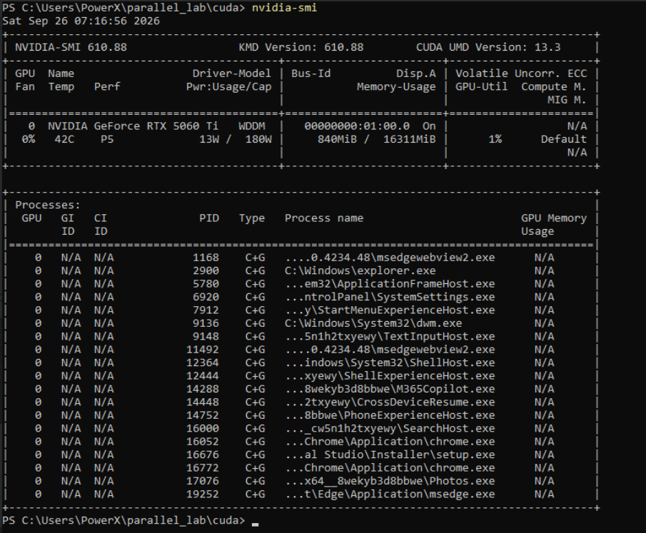

### NVCC Version
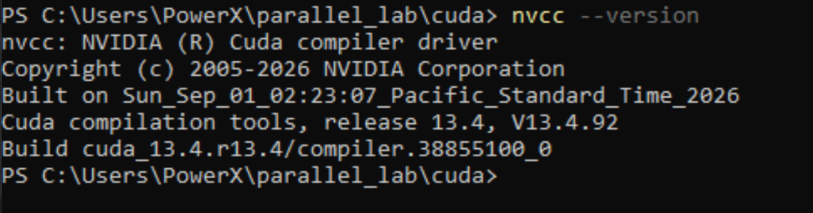

## Experimental Results

### Sequential Result

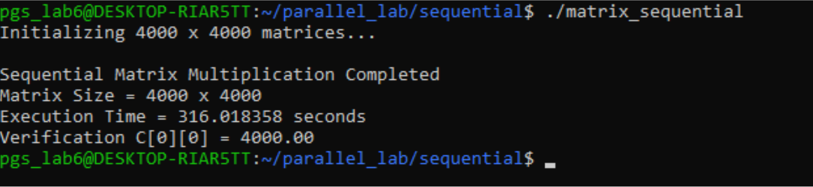

- **Matrix size:** 4000 × 4000
- **Execution time:** 316.018358 seconds
- **Verification:** C[0][0] = 4000.00

### OpenMP Result

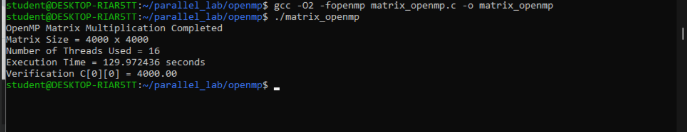

- **Matrix size:** 4000 × 4000
- **Threads:** 16
- **Execution time:** 129.972436 seconds
- **Verification:** C[0][0] = 4000.00

### MPI Result

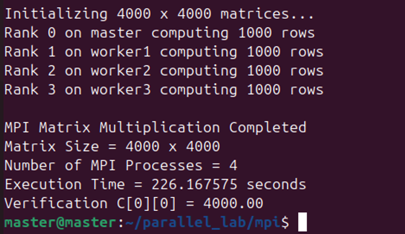

- **Matrix size:** 4000 × 4000
- **MPI processes:** 4
- **Distribution:** 1000 rows computed by each rank
- **Execution time:** 226.167575 seconds
- **Verification:** C[0][0] = 4000.00

*(Note: The MPI result is a reference benchmark for this version of the documentation.)*

### CUDA Result

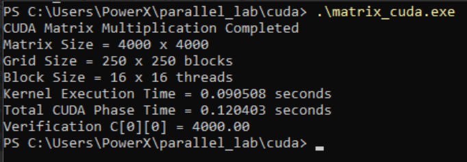

- **Matrix size:** 4000 × 4000
- **Grid size:** 250 × 250 blocks
- **Block size:** 16 × 16 threads
- **Total CUDA phase time:** 0.120403 seconds
- *(Kernel execution time: 0.090508 seconds)*
- **Verification:** C[0][0] = 4000.00

## Performance Comparison

| Implementation | Resources | Execution Time | Speedup | Verification |
|---|---|---:|---:|---:|
| Sequential | Single CPU execution | 316.018358 s | 1.00× | 4000.00 |
| OpenMP | 16 CPU threads | 129.972436 s | 2.43× | 4000.00 |
| MPI | 4 MPI processes | 226.167575 s | 1.40× | 4000.00 |
| CUDA | 250×250 blocks, 16×16 threads/block | 0.120403 s | 2624.21× | 4000.00 |

*(Note: MPI is clearly marked as a reference benchmark. CUDA execution time includes total CUDA phase time; the kernel execution took 0.090508 s).*

## Performance Visualizations

### Execution Time
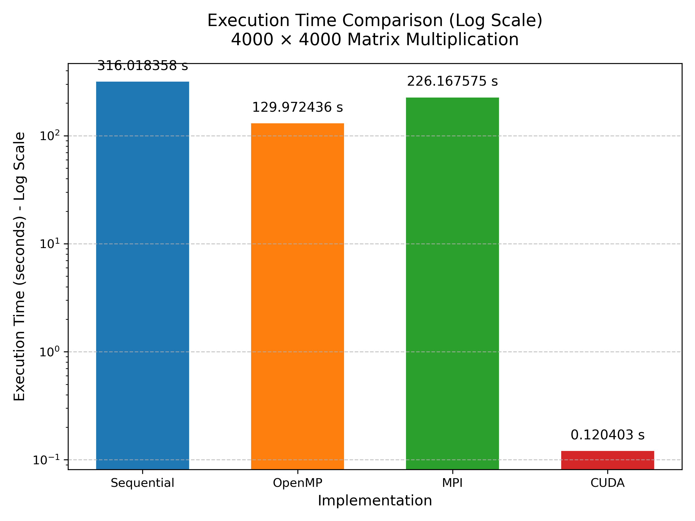

### Performance Overview
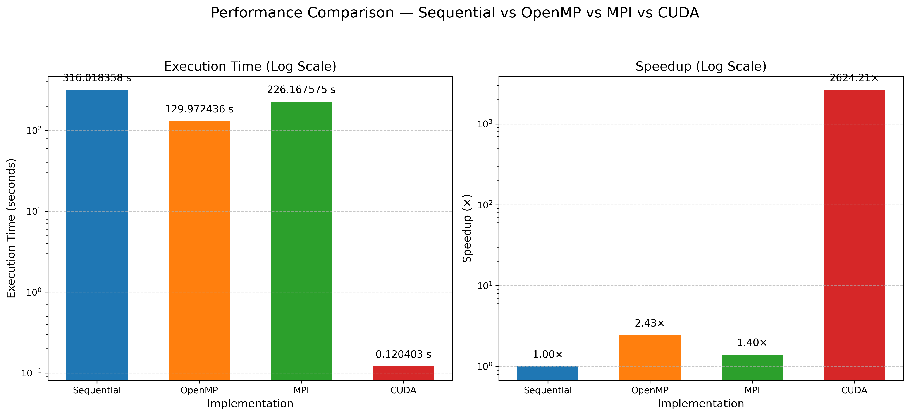

### Speedup
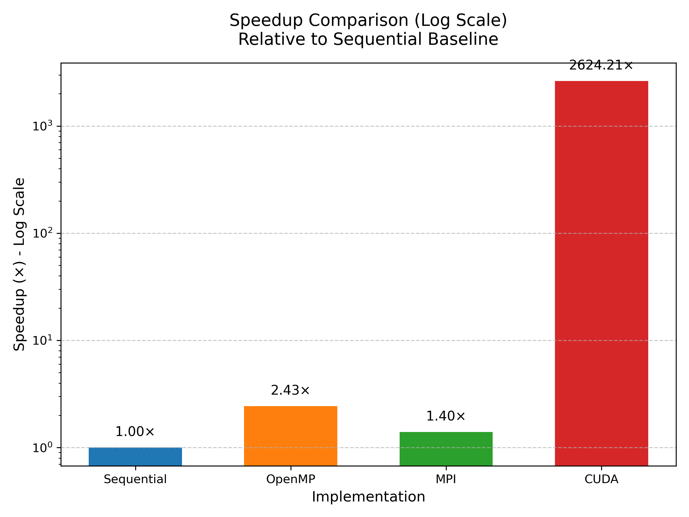

## Technical Analysis

The measured data highlights the characteristics of each computing model:

- **Sequential (316.018358 seconds):** The baseline performance reflects the standard single-core execution with $O(N^3)$ computational complexity. 
- **OpenMP (129.972436 seconds):** The shared-memory parallelization using 16 threads significantly reduced execution time. The measured speedup is approximately **2.43×**, showing effective distribution of iterations across threads.
- **MPI (226.167575 seconds):** The distributed-memory execution using 4 processes produced a speedup of approximately **1.40×**. While faster than the sequential baseline, it reflects the communication and process-management overhead inherent in passing large matrix chunks (1000 rows per rank) between the master and worker nodes in the reference run.
- **CUDA (0.120403 seconds total phase):** GPU acceleration provided dramatic improvements, with a speedup of **2624.21×** relative to the sequential timing. The kernel execution alone was extremely fast (0.090508 s). This result benefits from the massive GPU parallelism well-suited for this highly independent workload. However, it is specific to this workload, implementation, and execution environment (RTX 5060 Ti) and should not be seen as universally achievable for all types of computational problems.

## Correctness Verification

To ensure the accuracy of the computation, a correctness check was performed on the output.

For a matrix multiplication $C = A \times B$ where:
- Matrix dimensions are 4000 × 4000
- Every element of $A = 1.0$
- Every element of $B = 1.0$

Each output element is the sum of 4000 products of $1.0 \times 1.0$:

$C[i][j] = \sum_{k=0}^{3999} (1.0 \times 1.0) = 4000.0$

Therefore:

$C[0][0] = 4000.00$

All four implementations (Sequential, OpenMP, MPI, and CUDA) successfully show `C[0][0] = 4000.00`.

## Observations

- The shared-memory model (OpenMP) yielded a significant performance improvement (2.43× speedup) for this specific workload and execution environment.
- The distributed-memory model (MPI benchmark reference) improved execution time (1.40× speedup), though the gains were more modest in this configuration, likely due to data transfer overhead between the 4 processes.
- The GPU-accelerated model (CUDA) achieved exceptional gains (2624.21× speedup). GPUs excel at matrix operations due to thousands of ALUs effectively handling concurrent dot-product computations.
- All four programming models correctly computed the results for the 4000 × 4000 matrices.

## Conclusion

This experiment successfully demonstrated the performance differences between sequential and parallel implementations of matrix multiplication. The **Sequential** approach provided a baseline execution time of 316.018358 seconds. The **OpenMP** implementation reduced the measured execution time to 129.972436 seconds, achieving a speedup of 2.43× relative to the sequential baseline. The **MPI** reference run produced an execution time of 226.167575 seconds, representing a 1.40× speedup. Most notably, the **CUDA** implementation utilized GPU resources to dramatically accelerate computation, reducing the total CUDA phase time to 0.120403 seconds and achieving a 2624.21× speedup. All implementations correctly calculated the expected verification value of 4000.00, validating the parallel logic applied across all computing paradigms.

## Technologies Used

- C / C++ Programming Languages
- OpenMP (Open Multi-Processing)
- MPI (Message Passing Interface)
- CUDA Toolkit (NVIDIA)
- GCC / MPI / nvcc Compiler toolchains
- Python & Matplotlib (Performance visualizations)
